# Capturas manuales para la entrega

`01_inicio.png`
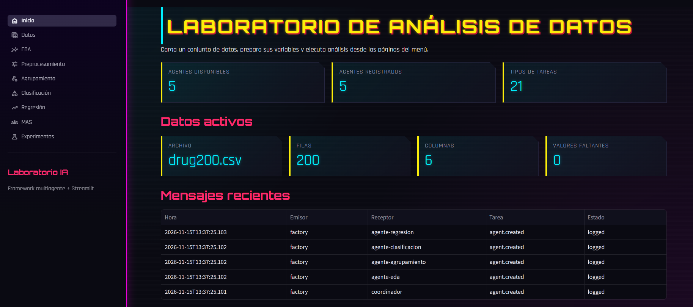

`02_datos.png`
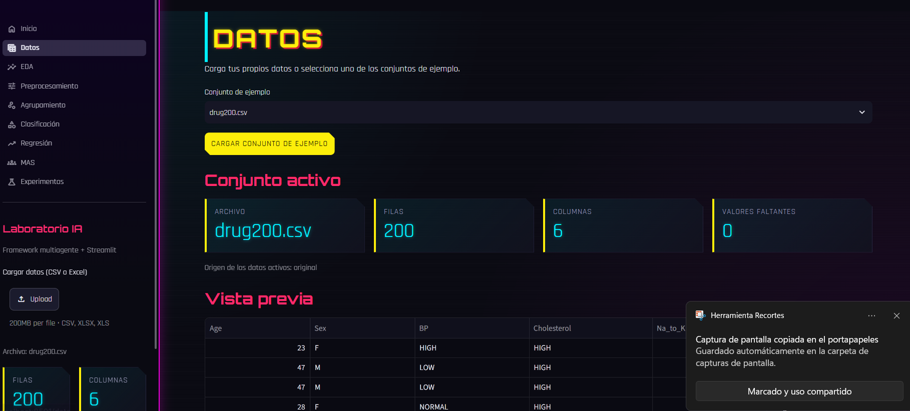

`03_preprocesamiento.png`
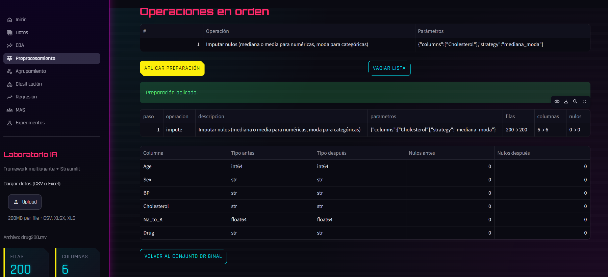

`04_benchmark_clasificacion.png`
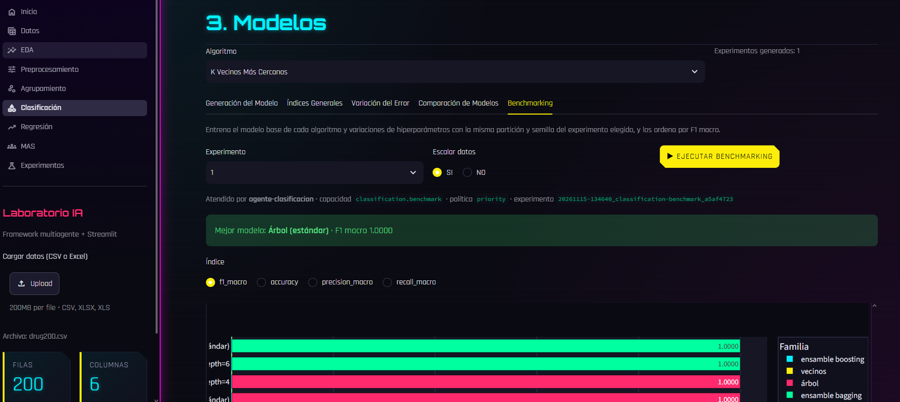
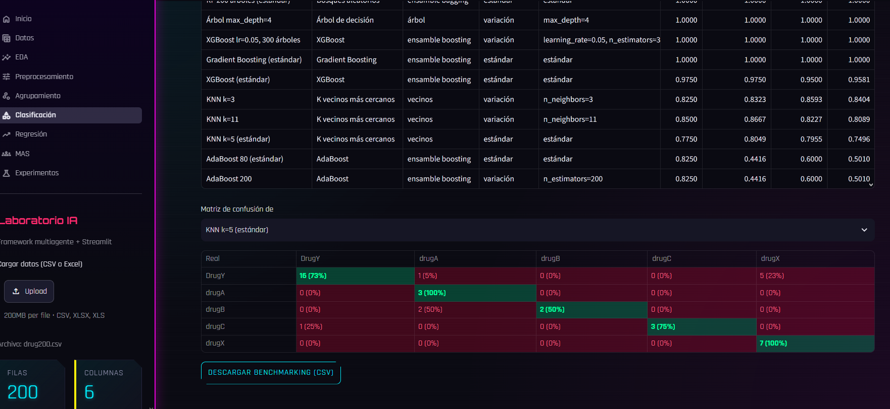

`05_benchmark_regresion.png`
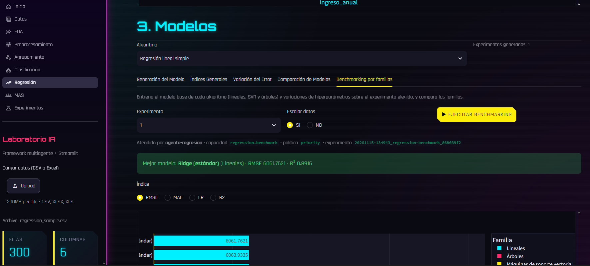
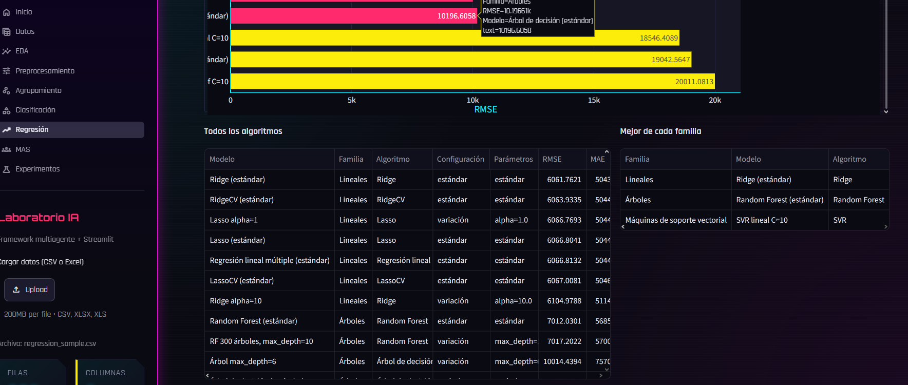

`06_benchmark_agrupamiento.png`
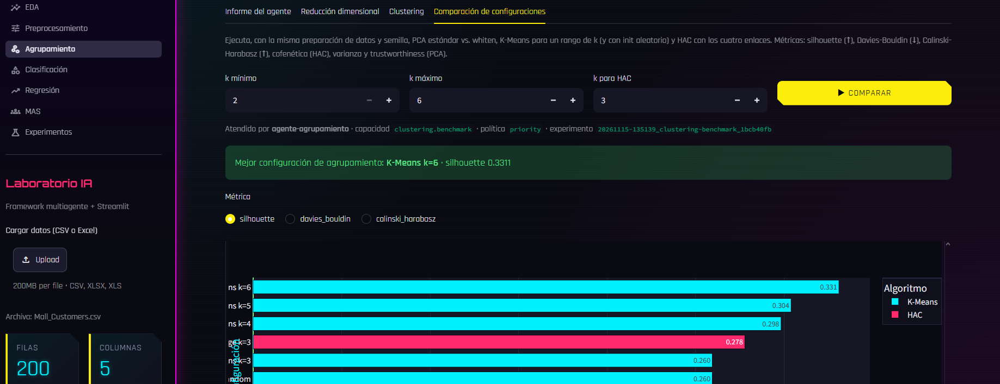
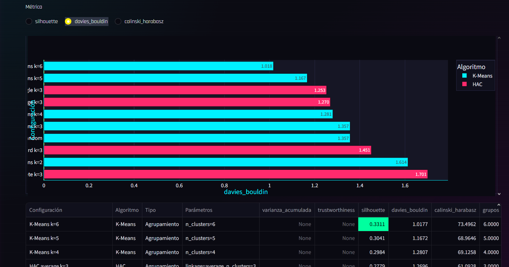
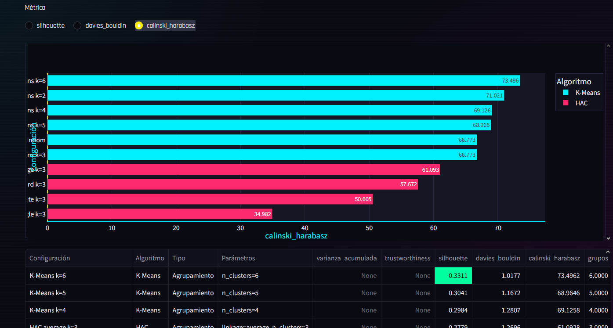

`07_mas_antes.png`
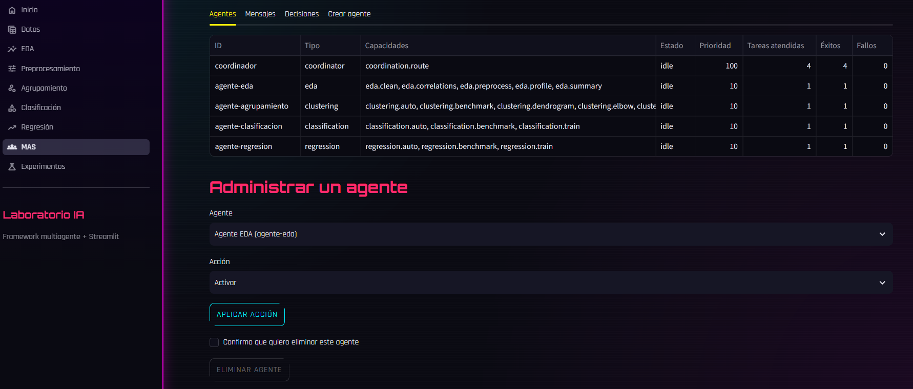

`08_mas_despues.png`
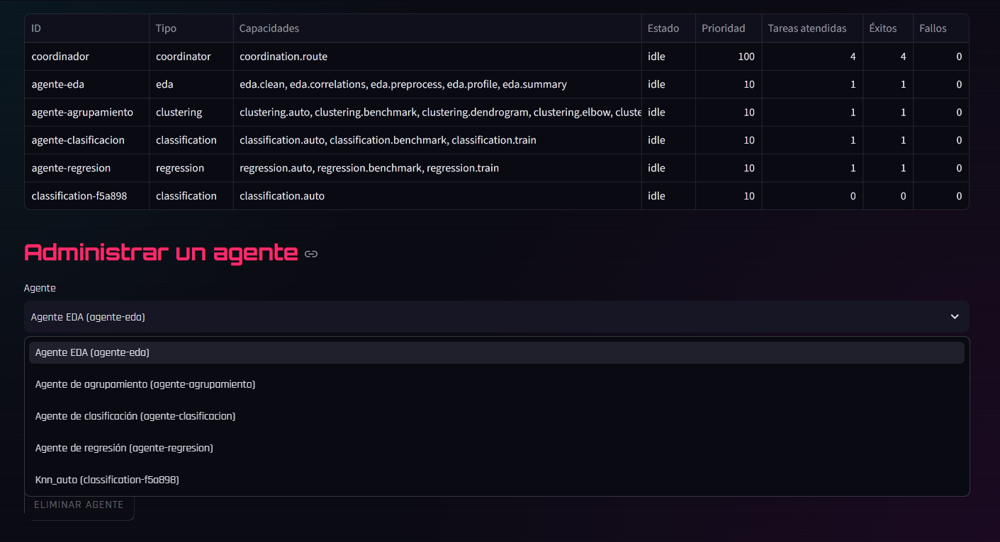

`09_mensajes.png`
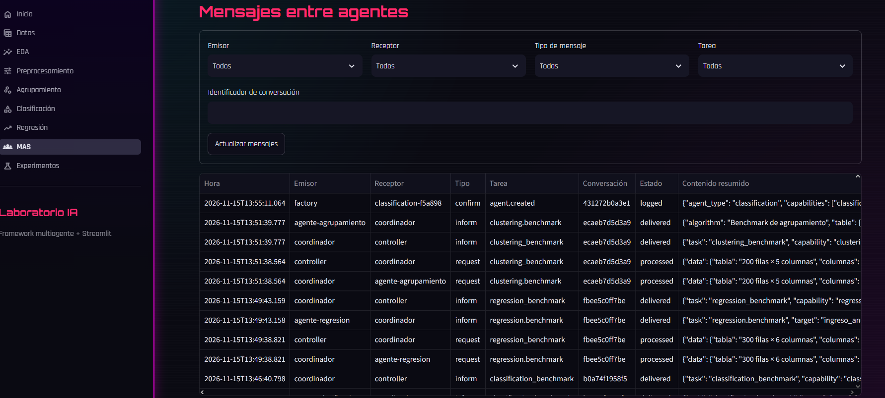

`10_decisiones.png`
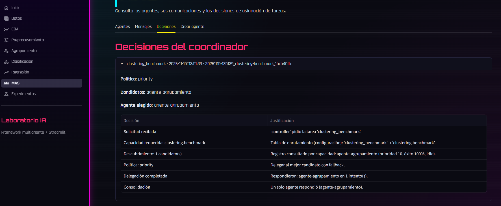

`11_experimentos.png`
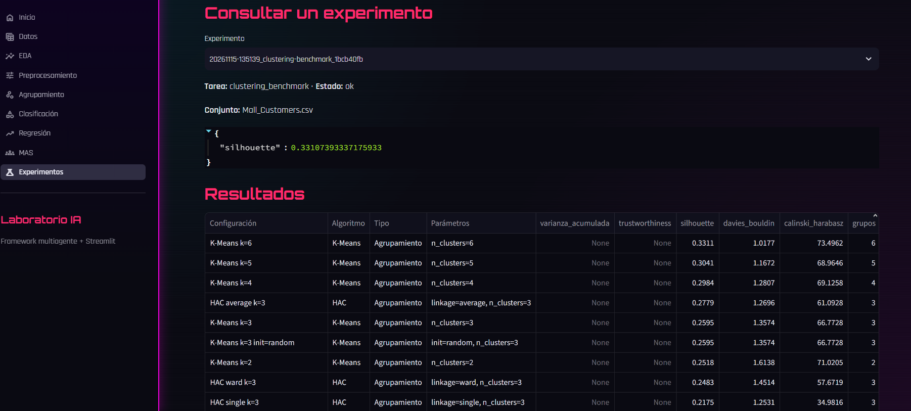